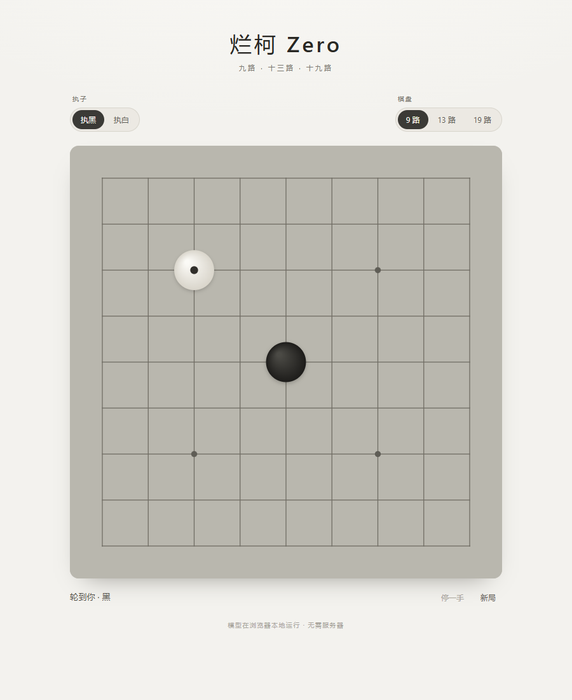

# 烂柯 Zero

面向 **9 / 13 / 19 路**棋盘的 AlphaZero 风格围棋引擎。同一份全卷积神经网络直接支持三种尺寸，配合 MCTS 完成自对弈训练；仓库同时提供浏览器本地演示和 Tk 对弈/训练界面。

<p align="center">
  
</p>

<p align="center">
  <a href="https://tlxgs.github.io/LankeZero/"><b>打开网页演示</b></a>
</p>

## 特性

- **一份权重，三种棋盘**：9 / 13 / 19 路共用同一个全卷积模型，策略头直接输出 `n*n+1`。
- **AlphaZero 式训练**：MCTS 自对弈、访问计数策略目标、归属/胜率辅助头、D4 数据增强。
- **本机单进程**：自对弈、训练、对弈和训练界面都在本机完成，不需要服务器或多 worker。
- **轻量网页演示**：浏览器内完成 ONNX 推理与 MCTS，优先 WebGPU，自动回退 WASM。
- **训练界面**：可调棋盘、模拟数、噪声、候选裁剪、学习率等参数；支持打开 `.npz` 手动修正策略标签。

## 网页演示

打开 [https://tlxgs.github.io/LankeZero/](https://tlxgs.github.io/LankeZero/)。

界面只保留两个设置：

- 执黑 / 执白
- 9 / 13 / 19 路

其余参数固定为对弈默认值：100 模拟/手、batch 8、候选质量 0.95、最少 8 个候选、根噪声 0、落子温度 0、贴目 7.5。推理和搜索在 Web Worker 中运行，不阻塞界面。

本地预览：

```bash
python web/server.py --port 8000
# 浏览器打开 http://127.0.0.1:8000/
```

## 快速开始

需要 Python 3.8+、PyTorch；训练建议使用 CUDA 显卡。

```bash
python -m venv .venv
# Windows: .venv\Scripts\activate
# Linux/macOS: source .venv/bin/activate

pip install -r python/requirements.txt
python python/gui.py        # 对弈界面
python python/train_gui.py  # 训练界面
```

本地运行需要一个训练权重 `model.pt`，放在仓库根目录。该文件不入库。

## 模型

| 项目 | 说明 |
|---|---|
| 输入 | 10 通道，含棋子、上一手、贴目、棋块危急度、眼、合法点、棋盘边界 |
| 主干 | 128 通道 × 10 个残差块 |
| 输出 | 策略 `n*n+1`、归属图、胜率 logit |
| 参数量 | 3,520,069 |

训练权重 `model.pt` 是唯一权重，训练时原地原子更新，不生成检查点。网页使用的 `web/model/model.onnx` 由它导出，仅供浏览器演示，不参与训练。

## 目录

```text
index.html          网页入口
python/
  game.py           规则、劫、终局与输入编码
  model.py          CNN 三头网络
  mcts.py           Numba MCTS
  selfplay.py       自对弈
  replay.py         紧凑数据与回放
  train.py          训练循环
  gui.py            对弈界面
  train_gui.py      训练界面
  tests/            单元测试
web/
  js/               浏览器规则、MCTS、worker、界面
  model/            网页 ONNX 模型
  vendor/ort/       ONNX Runtime Web
  tools/            模型导出脚本
```

## 测试与基准

```bash
python python/tests/test_core.py
python python/bench.py --sims 300 --batch 16 --moves 5
```

## 第三方

浏览器推理使用 [ONNX Runtime Web](https://github.com/microsoft/onnxruntime)，MIT License；静态文件位于 `web/vendor/ort/`。
